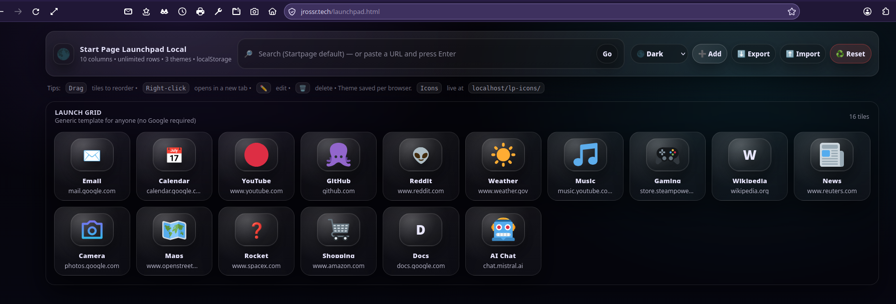
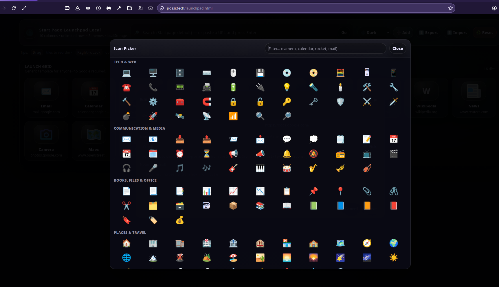

# Start Page Launchpad

A personal browser start page / app launchpad in a **single self-contained HTML file**. No build step, no framework, no CDN, no backend — drop one file (plus the optional icon packs) on any web server, or open it locally, and go.



Tile view and the icon picker (all three icon sources in use):



## Features

- **Tiles** — name a site, give it a URL, pick an icon. Click to open in a new tab.
- **Three icon sources:**
  - **Built-in emojis** — native, instant, colorful on modern systems
  - **Twemoji pack** — 3,689 full-color emoji SVGs that render identically on *every* OS, including older ones (Windows 7 included) where native emoji render flat
  - **SVG Pack** — 53 starter icons (camera, calendar, rocket, mail, and more) that paint themselves in your theme's gradient
- **Letter icons** — just want a big bold "D" for Docs? There's a type for that.
- **Three themes** — Default, Neon, and Tactical, each with its own glassmorphism, glow, and gradient accent
- **Unlimited tiles** — the grid grows as you do; drag tiles to reorder, edit or delete any time
- **Import / Export** — your layout is a portable JSON blob; back it up, move it to another browser, share a layout with a friend
- **No accounts, no tracking** — everything lives in your browser's localStorage

## Install

### On a web server

1. Upload `launchpad.html` to your site root.
2. Upload the `lp-icons/` folder to the site root as well (the page looks for icons at `/lp-icons/`).
3. Visit `launchpad.html` in your browser.

For the Twemoji tab to come alive, generate its manifest from the server shell:

```bash
cd lp-icons/twemoji
ls -1 *.svg | jq -R . | jq -s . > icons.json
```

(`jq` not installed? Any way of producing a JSON array of the SVG filenames works.)

### Locally

`launchpad.html` runs straight from the filesystem — double-click it. The emoji tab works everywhere; the SVG-pack and Twemoji tabs need the icon folders served over HTTP (or adjust `ICON_BASE` / `TWEMOJI_BASE` at the top of the file to point wherever your icons live).

## Files

```
launchpad.html            the entire app
lp-icons/                 53-icon starter SVG pack + icons.json
  twemoji/                full Twemoji set (3,689 SVGs) + licenses + manifest
make_launchpad_icons.sh   helper script
```

## Credits & licenses

- This project's code: MIT — see `LICENSE`.
- Emoji artwork by [Twemoji](https://github.com/twitter/twemoji), licensed under CC-BY 4.0 — see `lp-icons/twemoji/LICENSE-GRAPHICS`.

## Made by

**John Robertson** — Black Wolf ecosystem. Try the live demo at [jrossr.tech](https://jrossr.tech/launchpad.html) and grab the full package zip from the [downloads page](https://jrossr.tech/downloads/launchpad.zip).
